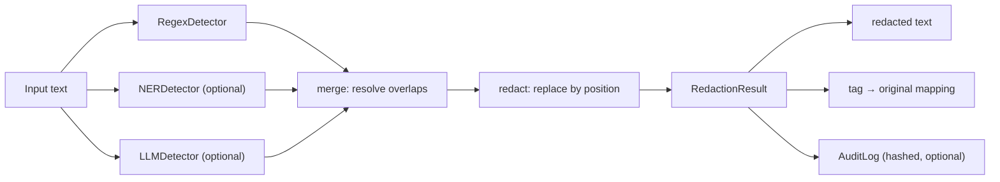

# Local PII Redactor

Find and redact personal information (PII) in text **entirely on your own machine**. Nothing is sent to a cloud service.

```
Contact Priya Sharma at priya.s@gmail.com or +91 98765 43210.
→ Contact [PERSON_1] at [EMAIL_1] or [PHONE_1].
```

It combines fast pattern matching (regex with checksums) with an optional spaCy model and an optional local LLM (via [Ollama](https://ollama.com)). The tags can be reversed later, so you can redact a document, send it to any AI tool, and put the real values back into the answer.

---

## Why use it

- **Share text with AI tools without sharing the people in it.** Redact a support ticket, medical note or HR email, paste the redacted version into a chatbot, then call `restore()` on the reply to put the real names back.
- **Local by design.** The core uses only the Python standard library. The LLM layer talks to Ollama on `localhost`. No API keys, no accounts, no network calls to third parties.
- **Built for Indian data as well as global data.** It detects Aadhaar (with the Verhoeff checksum), PAN, IFSC and Indian mobile numbers, alongside email, cards (with the Luhn checksum), IPs, URLs and dates of birth.
- **Catches what regex can't.** Names, organisations, job titles and places depend on context, so the NER and LLM layers handle them. Regex handles anything with a fixed shape.
- **Safe failure modes.** The LLM can't alter or drop your text, only point at parts of it. Anything it invents is discarded. The audit log never stores the raw values.
- **Usable as a CLI or a library.** `python -m redactor notes.txt`, or `Pipeline.default().run(text)` from Python.

> It is one layer of protection, not a compliance guarantee. Detection is never 100%, so review the output for anything sensitive (see [Limitations](#limitations)).

---

## Setup

Requires **Python 3.9+** (developed on 3.12). The core needs no extra packages.

### 1. Clone and create a virtual environment

```powershell
git clone https://github.com/vs-29/Local-PII-Redactor.git
cd Local-PII-Redactor
python -m venv venv
```

Activate it:

```powershell
# Windows PowerShell (the first line allows the activate script for this session only)
Set-ExecutionPolicy -Scope Process -ExecutionPolicy RemoteSigned
.\venv\Scripts\Activate.ps1
```
```bash
# macOS / Linux
source venv/bin/activate
```

### 2. Check it works (regex layer, no extra installs)

```powershell
cd pii-redactor
python -m unittest discover -s tests
"Call Priya on 9876543210 or priya@x.com" | python -m redactor --no-llm --show
```

> **Run commands from the `pii-redactor` folder.** That is where the `redactor` package lives. Running from the repo root gives `ModuleNotFoundError: No module named 'redactor'`.

### 3. Optional: spaCy NER layer

```powershell
pip install spacy
python -m spacy download en_core_web_sm
```

The pipeline detects spaCy automatically and skips it if it isn't installed.

### 4. Optional: local LLM layer (Ollama)

1. Install Ollama from <https://ollama.com>.
2. Pull the default model (about 1 GB):
   ```powershell
   ollama pull qwen2.5:1.5b-instruct
   ```
3. Make sure Ollama is running (`ollama list` should answer), then:
   ```powershell
   python -m redactor --show notes.txt
   ```

Without Ollama, add `--no-llm`. Otherwise you get a clear error that tells you to use it.

### 5. Set an audit salt (if you use `--audit`)

```powershell
$env:PII_AUDIT_SALT = "a-long-random-secret"     # PowerShell, current session
```
```bash
export PII_AUDIT_SALT="a-long-random-secret"     # macOS / Linux
```

Without a salt, a warning is shown, because hashes of short values like phone numbers can be reversed by guessing (see [Learnings](#learnings-and-gotchas)).

---

## Usage

### Command line

```powershell
python -m redactor --no-llm notes.txt                 # regex (+ spaCy if installed), no Ollama
python -m redactor notes.txt --show                   # also list each detection on stderr
python -m redactor notes.txt --mask                   # █████ instead of tags (not reversible)
python -m redactor notes.txt --out notes.redacted.txt --map map.json --audit
python -m redactor notes.txt --audit --audit-file logs/audit.jsonl
python -m redactor notes.txt --model llama3.2:3b      # use a different Ollama model
type notes.txt | python -m redactor --no-llm          # read from stdin
```

| Option | Meaning |
|---|---|
| `FILE` | input file (default: stdin) |
| `--out PATH` | write redacted text to a file instead of stdout |
| `--map PATH` | write the `tag → original` mapping as JSON (**contains PII, so keep it private**) |
| `--no-llm` / `--no-ner` | turn off a detector layer |
| `--model NAME` | Ollama model to use |
| `--mask` | replace with `█` of the same length; no mapping is kept |
| `--audit` | append a record to the audit log |
| `--audit-file PATH` | audit log path (default `redaction_audit.jsonl`) |
| `--show` | print detections (label, detector, text) on stderr |

### Python

```python
from redactor.pipeline import Pipeline

pipe = Pipeline.default()                 # regex + spaCy (if installed) + LLM
result = pipe.run("Dr. Rao referred Priya Sharma to Apollo Hospital.")

print(result.redacted)   # [PERSON_1] referred [PERSON_2] to [ORGANIZATION_1].
print(result.mapping)    # {'[PERSON_1]': 'Dr. Rao', '[PERSON_2]': 'Priya Sharma', '[ORGANIZATION_1]': 'Apollo Hospital'}
print(result.entities)   # list of Entity(start, end, text, label, source, score)
```

The exact LLM output varies by model.

**Round trip through an external AI tool:**

```python
result = Pipeline.default().run(email_text)
answer = some_chatbot(result.redacted)    # the tool only ever sees [PERSON_1], [EMAIL_1], ...
print(result.restore(answer))             # real values are put back locally
```

**Choose your own detectors** (for example regex only, for speed):

```python
from redactor.pipeline import Pipeline
from redactor.detectors.regex_detector import RegexDetector
from redactor.audit import AuditLog

pipe = Pipeline([RegexDetector(labels={"EMAIL", "PHONE"})],
                style="tag", auditor=AuditLog("audit.jsonl"))
```

---

## Architecture

### Data flow



1. **Detect.** Each detector independently returns a list of `Entity(start, end, text, label, source, score)`.
2. **Merge.** Overlapping detections are resolved, so exactly one entity covers each region of text.
3. **Redact.** Spans are replaced by character position with numbered tags (or masks).
4. **Record.** The result carries the redacted text, the entities and the mapping. The audit log optionally appends a hashed summary.

### Project layout

```
pii-redactor/
├── redactor/
│   ├── models.py             # Entity and RedactionResult data types
│   ├── detectors/
│   │   ├── regex_detector.py # patterns + Luhn / Verhoeff checksums
│   │   ├── ner_detector.py   # optional spaCy NER
│   │   └── llm_detector.py   # optional Ollama, JSON-schema output
│   ├── pipeline.py           # runs detectors, merge() resolves overlaps
│   ├── redact.py             # position-based replacement, tags or masks
│   ├── audit.py              # append-only JSONL log with salted hashes
│   └── __main__.py           # command line: python -m redactor
├── tests/test_redactor.py    # unit tests, no Ollama or spaCy needed
├── evals/                    # (planned) precision/recall evaluation
└── review_app.py             # (planned) human review UI
```

### Detection layers

| Layer | Finds | Confidence | Needs |
|---|---|---|---|
| **Regex** | EMAIL, PHONE, URL, AADHAAR (Verhoeff), PAN, CREDIT_CARD (Luhn), IFSC, IP_ADDRESS, DATE_OF_BIRTH | 1.0 | nothing |
| **NER** | PERSON, ORGANIZATION, LOCATION | 0.7 | spaCy + `en_core_web_sm` |
| **LLM** | PERSON, ORGANIZATION, JOB_TITLE, LOCATION, using context | 0.8 | Ollama + `qwen2.5:1.5b-instruct` |

### Design patterns used

| Pattern | Where | Why |
|---|---|---|
| **Common interface (duck typing / Strategy)** | every detector has `name` + `detect(text) -> list[Entity]` | The pipeline doesn't care how a detector works, so a new one is a new class and nothing else changes. No base class is needed. |
| **Immutable value object** | `Entity` is a `@dataclass(frozen=True)` | It can't be changed by accident after detection. Frozen also makes it hashable, so `merge()` can remove duplicates with `set()`. |
| **Pipeline** | `Pipeline.run` → detect → merge → redact → audit | Each stage does one job and can be tested on its own. |
| **Dependency injection** | `Pipeline(detectors=[...], auditor=...)` | Callers (and tests) choose the parts. Tests pass in a fake LLM instead of a real one. |
| **Factory method** | `Pipeline.default()` (a `@classmethod`) | One place that knows the sensible default setup, including which optional layers are available. |
| **Lazy optional imports** | `import spacy` inside `NERDetector.__init__` | The package works without heavy optional dependencies installed. |
| **LLM as extractor, not editor** | `LLMDetector` + `find_spans()` | The model only *lists* strings in a forced JSON schema. Python finds them in the original text, and anything not found is discarded as a hallucination. The model can never rewrite or drop your text. |
| **Edit by position** | `redact()` builds output from `text[cursor:e.start]` slices | Only the detected spans change. Unlike `str.replace`, "Ravi" is never hit inside "Ravindra". |
| **Greedy interval selection** | `merge()` | Sort by (longest, highest score, source priority, position) and keep each span that doesn't overlap a kept one. When in doubt it redacts more, which is the safe direction. |
| **Privacy by design** | `audit.py`, `.gitignore` | The log stores salted SHA-256 hashes, never values. Output files that contain PII (`*map*.json`, `*.redacted.txt`, the audit log) are ignored by git. |
| **Test seam** | `LLMDetector._ask()` is separate from `detect()` | Tests override only the network call (`FakeLLM`), and all the real parsing and guard logic still runs. |

---

## Learnings and gotchas

Things this project taught me, often by hitting the bug first:

**Python**
- `@dataclass(frozen=True)` gives immutability **and** hashability. Hashability is what lets entities go into a `set`.
- `x if x is not None else default` instead of `x or default`. With `or`, a valid empty value (`[]`, `""`) is quietly replaced by the default.
- Sort keys can be tuples: `key=lambda e: (-len(e), priority, e.start)` sorts by several rules at once, and the minus sign reverses one of them.
- Build strings by appending to a list and calling `"".join(parts)`, not with repeated `+=`.
- `python -m package` runs `package/__main__.py`, and relative imports only work when the code is run that way.
- `main(argv=None)` makes a CLI testable: tests call `main(["--no-llm", "file.txt"])` directly.

**Regex and validation**
- A regex only checks the *shape*. Checksums (Luhn for cards, Verhoeff for Aadhaar) check that the number is *valid*, which removes most false positives on random digit strings.
- `re.escape()` any user or LLM string before putting it inside a pattern. `(?<!\w)…(?!\w)` gives whole-word matching.
- Test what should **not** match as well as what should ("sold 1500 units in 2024" must produce nothing).

**LLMs**
- Use structured output (a JSON schema in Ollama's `format`) plus `temperature: 0` for repeatable, parseable answers.
- Never trust model output blindly: check every string against the source text. In testing, the model returned "Apollo Hospital" and "Pune" from the *prompt's example* for text that contained neither, and the guard dropped them.
- Long input is split into overlapping chunks (`chunk_text`). The model is asked about each chunk, and every value it returns is then searched for in the *full* text, so no offset arithmetic is needed.
- Always cap the output length (`num_predict`). A 1.5B model got stuck repeating `"vendor contracts"` and, without a cap, ran past the 120 s timeout. That looked like a long-document problem, but it was a repetition loop.
- "Will" the person vs "will" the verb is a **part-of-speech** question. spaCy's tagger (`token.pos_`) answers it from the sentence: "Ask **Will**" → PROPN, "**Will** you…" → AUX. The model's exact spelling is always redacted, and the tagger only decides the *extra* case variants, so it can add redactions but never remove one.
- Taggers are context-dependent and imperfect: lowercase "priya" was PROPN in one sentence and NOUN in the next, and "Thanks, WILL" came out as AUX. When unsure, choose the rule that over-redacts.
- Measure before you fix: the timeout was first blamed on length, and logging `eval_count` and `done_reason` per chunk showed the real cause.

**CLI and Windows**
- `argparse` with `nargs="?"` on an option can swallow the next argument. An earlier `--audit notes.txt` appended the log *into the input file*. The fix was to split it into a flag (`--audit`) and a path (`--audit-file`), and a test now covers it.
- Windows consoles and pipes may default to `cp1252`, which can't encode `█` or non-Latin names. The CLI switches stdout/stderr to UTF-8, and every `open()` passes `encoding="utf-8"`.
- Windows PowerShell 5.1 pipes text to programs as ASCII, so non-English names arrive as `?`. Use a file input for those.
- Run Python from the folder that contains the package. Run git from the repo root.

**Security**
- Hashing is not anonymisation when the possible values are few. An unsalted hash of a phone number was reversed by brute force in under a second for a 600k-number range. Use a long, secret `PII_AUDIT_SALT`.
- The mapping file *is* the PII. Treat it like the original document.

**Testing**
- Replace only the external part (the HTTP call) with a fake, and keep the real logic under test.
- Watch a test fail once (break `luhn_valid` on purpose) to prove it really checks something.
- `tempfile.TemporaryDirectory()` keeps tests from leaving files behind. On Windows, close files (`with open`) before the directory is deleted.

---

## Limitations

- **Detection is not perfect.** Small LLMs and spaCy miss some names, especially non-English ones. Check the output with `--show`.
- **Case variants lean toward over-redaction.** If the model returns `Will` (a person), the exact spelling is redacted everywhere, including "Will you…?". ALL-CAPS variants are always redacted ("I WILL CALL"). With spaCy, a common noun that matches a name ("hope" when the model found "Hope") is also redacted. Without spaCy, lowercase variants are skipped.
- **All spellings share one tag**: `Priya`, `priya` and `PRIYA` all become `[PERSON_1]`, so an AI tool sees one person. `result.restore()` still returns the exact original, but `restore(answer)` puts back a single spelling, preferring the normal one (`Priya`) over all-lowercase or ALL-CAPS.
- **Every whole-word occurrence of an LLM-found value is redacted**, e.g. every "Pune". That is safe, but it can over-redact.
- **Small models can get stuck repeating themselves**, especially on repetitive text. Replies are capped (`max_output_tokens`) and the complete items are kept, but names in that chunk can be missed. In a 29k-character test, 8 of 10 names were found. A larger model (`--model`) helps.
- **The LLM also over-flags**: on business text, `qwen2.5:1.5b` sometimes labels ordinary words ("budgets") as JOB_TITLE, and every occurrence then gets redacted.
- **NER is English-only** with `en_core_web_sm`.
- **spaCy's small English model mislabels many Indian names**: "Ananya" as a place, "Rohit" and "Kavita" as organisations. With the LLM on, its higher score wins the tie and the label is corrected to PERSON. With `--no-llm` the wrong labels stay (the text is still redacted), and some names, like "Priya", are missed.

---

## Tests

```powershell
cd pii-redactor
python -m unittest -v
```

39 tests cover the regex patterns and checksums, the LLM hallucination guard, chunking and cut-off replies, case-variant matching (the spaCy ones are skipped if spaCy isn't installed), overlap merging, tag consistency and `restore()`, mask mode, and the audit log never containing raw values. Ollama and spaCy are not needed, because the LLM is replaced by a fake detector.

---

## Roadmap

- [ ] `review_app.py`: a person approves or rejects detections before export
- [ ] `evals/run_eval.py`: precision and recall against a labelled sample set
- [x] Chunking for long documents sent to the LLM
- [x] Case-variant matching for LLM-found values, with a part-of-speech check
- [x] Use `score` to resolve conflicts
- [ ] A confidence threshold option
- [ ] A `requirements.txt` / `pyproject.toml` for the optional extras

## License

[MIT](LICENSE)
